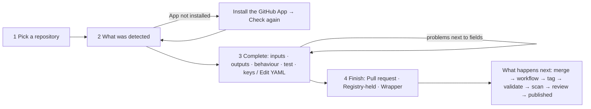

# Website redesign plan (otinstaller.com)

Written 21 October 2026 from an audit of production, the source in `web/`, the product plan ("OTInstaller
Registry — Free Version Plan", 19 Oct 2026) and a survey of comparable registries. It is a plan, not a build:
nothing in `web/src` changes until the direction is approved. The static mockups are in
[`web/design/`](../web/design/README.md); audit screenshots are in [`web-redesign/audit/`](web-redesign/audit/).

**Recommendation in one paragraph.** Keep the stack (Astro SSR on Cloudflare, Preact islands, strict CSP, edge
cache) and every public URL, and rebuild the *presentation layer* around three things the current site does not
do: (1) a single **type-detecting "paste what you have" box** as the primary way in, backed by `/input/{type}`
pages that are real landing pages; (2) a tool page whose top half is an **evidence panel** (digest, signer, scan
date, smoke test, health, backup copy) instead of a row of unexplained badges; (3) a **design system aligned with
OSINTverse's** (monospace display type, square corners, neutral surfaces, semantic colour only for meaning), with
motion cut to what reduced-motion users never miss. Ship it in four phases; the first (tokens, layout shell,
home, search, tool page) is about two weeks for one person and goes live behind the existing URLs without
touching the API.

---

## 1. Audit of the current site

### Method

- Production (`https://otinstaller.com`) on 21 Oct 2026, site build `cf699a53` (beta strip off), 37 tools and
  10 guides, in the desktop app's built-in browser: 1366×900 desktop and 375×812 mobile, dark and light,
  plus `PerformanceObserver` timings and a contrast scan run inside the page.
- Signed-in pages (dashboard, import wizard after sign-in, admin console) were audited from source
  (`web/src/islands/*.tsx`), because the audit browser has no registry session and this task must not sign in.
- Evidence: 22 screenshots in `docs/web-redesign/audit/`. File names say page, width and theme.

### What the site does well (keep these)

- **Right architecture.** SSR from the public API with `cacheFor`, islands only where a session matters, strict
  CSP with hashed scripts, self-hosted fonts, cookieless analytics. None of this needs to change.
- **Search dialog** (`SearchDialog.tsx`): a native `<dialog>`, `role="listbox"`, `aria-live`, focus returns to the
  trigger on Escape. The best interaction on the site and the model for the rest.
- **Copy semantics.** Plain sentences, next command in backticks, hints that name an `ot` command. The install
  block detects the OS and works without JavaScript (radio tabs).
- **Tool header** carries the right facts (namespace, version, summary, deprecation, community-packaged notice,
  source-unavailable notice); the breadcrumb goes to the publisher.
- **404 and 410 pages** search instead of apologising; removed packages link to transparency.
- **Guide reader** has a left nav, contents, page x of y, a version switcher and a tools panel with install
  commands and an "install all" command.
- **Trust facts exist in the data**: signer identity, scan rows with dates, SBOM count, smoke-test timing,
  health, backup state. The problem is presentation, not availability.

### Findings by page

| Page | Works | Friction, dead ends, inconsistencies | Evidence |
| --- | --- | --- | --- |
| Home `/` | Clear promise, server-rendered terminal demo, "I have a…" tiles, trust pipeline. | Six sections, so the **first action is unclear**: "Install ot" jumps to an anchor, "Browse tools" and a free-text box compete, and the "I have a…" tiles are the third screen. Every card shows **"↓ 0 ★ 0"** on 37 of 37 tools. "Trending this month" is false with zero installs. The shimmer, drifting blurred blobs and dot grid loop forever (light theme: blobs wash out the hero). Content below the hero is `opacity: 0` until an `IntersectionObserver` fires (35 `.reveal` elements): in the audit browser **none of them ever appeared**; the LCP element (`h1.fade-in`) painted at 2.4 s on a warm cache because of a 520 ms fade with staggered delays. | `home-desktop-dark.jpg`, `home-desktop-light.jpg`, `home-light-after-2s.jpg` (blank hero two seconds after load), `home-mobile-first-paint.jpg` |
| Search `/search` | Facets (Takes, Finds, Category, Runtime), "No API key needed" toggle, four sorts, result count, empty state with chips, mobile drawer. | **Cards with eight badges each**; badges repeat the facets (Docker/pipx, No API key) and "Verified publisher" / "Community-packaged" are on every card, so nothing differentiates. No way to paste a value and get the tools for it. "Healthy" is unexplained. "More results" reloads with a cursor and loses scroll position. Facet values are `text-transform: capitalize` on raw enum names. The four-way sort wraps to two rows on mobile. | `search-desktop-dark.jpg`, `search-mobile-dark.jpg` |
| Input landing `/input/email` | Title, lead, link to guides. | Lead says "Tools that take **a email**". One tool today, so the page looks empty; no "start from a guide" or pivot content, which is what this page is for. | `input-email-desktop-dark.jpg` |
| Tool page `/{ns}/{name}` | Install/run block first, README, inputs with descriptions, keys, plain-words ethics, details, guides using this tool. | **Eight badges and "★ 0 ↓ 0 / 30 days" above the fold** say less than three sentences would. The sidebar comes after the README on mobile, so a phone user scrolls the whole README to learn the inputs. The example run copies `<username>` verbatim. "Signed" sits beside a Security tab whose newest row says **"Signature: Did not verify"** (next row). Guides are below the fold. No sample of the output, though every run returns the same envelope. | `tool-maigret-desktop-dark.jpg`, `tool-maigret-desktop-light.jpg`, `tool-maigret-mobile-dark.jpg` |
| Security tab | Signer identity and issuer in a highlighted block; every scan with its date. | **Two scan runs interleaved with no boundary**: "Signature: Did not verify, published by GitHub:soxoj/maigret, not osintverse-community/maigret · Failed" directly above "Signature: Signed by pypi:GitHub:soxoj/maigret · Passed". A visitor cannot tell the first was an earlier run with a wrong expected identity. No digest or wheel hash, no SBOM download, no Rekor link, no backup status, no vulnerability list (just counts). | `tool-security-desktop-dark.jpg` |
| Versions tab | Table with scan, signed, install per version. | One row for most packages. The "yanked versions stay installable" sentence shows even when nothing is yanked. No link to the tag's commit. | — |
| Guides `/guides` | Search, filters, sort. | **Thirty-two filter chips** across four rows before the first guide; two screens of chips on mobile. "Community-packaged" on first-party guides. | `guides-desktop-dark.jpg` |
| Guide reader | Nav, contents, tools panel, version switcher. | **Six install commands come before the first paragraph**; on mobile that is two screens of copy buttons before "Scope and legal". "Version [select] Go" needs a second click. "Contents" and the in-page "Steps" list duplicate. | `guide-email-desktop-dark.jpg`, `guide-email-mobile-dark.jpg` |
| Publisher `/{ns}` | Avatar, badges, counts, since-date, GitHub link. | One unsorted grid of eight-badge cards (alphabetical, so `btc-address` leads). No filter by input type, no search within the publisher. | `publisher-desktop-dark.jpg` |
| Docs | Left nav, "On this page", copy buttons. | Fine. Install commands are duplicated by hand in `InstallTabs.astro` and `getting-started.md`. No prev/next links. Code blocks have no prompt marker. | `docs-getting-started-dark.jpg` |
| Policies, transparency | Short, readable, a real removals table. | No reason-category definitions; removal rows link nowhere; "other" is the only reason used; policies missing from the sitemap. | `transparency-dark.jpg` |
| Import `/import` (signed out) | One-paragraph explanation, mentions `ot import`. | **"Loading your account…" with skeleton bars** before the sign-in buttons: the island calls `/me` first. No SSR explanation of what the wizard does, no sample manifest. | `import-signed-out-dark.jpg` |
| Import (signed in, from source) | Provider toggle, repo filter, detect, YAML editor with problems and hints, finish modes. | **One long screen with a raw `<textarea>` of YAML**: no step indicator, no form for what the detector could not guess (inputs, outputs, ethics answers), no preview, no "what happens next". The registry-held penalty is one grey sentence under the buttons. | `ImportWizard.tsx` |
| Dashboard (signed out) | Three sign-in buttons, a privacy sentence. | Fine. The header shows "Dashboard" to everyone with no account state. | `dashboard-signed-out-dark.jpg` |
| Dashboard (signed in, from source) | Namespaces with review state, publish history with error codes linked to docs, backups, tokens. | **Tables, not a dashboard**: no package list with health/scan state, no sync status per package, no next step when the namespace is pending. GitLab publishers see no jobs (known API gap). Revoke uses `window.confirm`. | `Dashboard.tsx` |
| Admin console (from source) | Redesigned in `ddc2c54`; counts tiles, review queue with criteria, reports, transfers, audit, feedback, beta. | Out of scope beyond adopting the tokens. | `AdminConsole.tsx`, `admin.css` |
| Feedback | Kinds, message, optional email, bug link. | No note on what happens after sending. Fine for now. | `feedback-dark.jpg` |
| 404 / 410 / 500 | Search box, links, request ID. | Good. | `404-dark.jpg` |
| Header, footer | Sticky header, shortcut hint, theme toggle, four-column footer. | **No sign-in state** in the header. The footer repeats the install command at 12.8 px with horizontal scroll on mobile. The staff "Admin" link costs a `/me` call per tab every 10 minutes on every page. | all |

### Cross-cutting findings

**Performance** (home page, warm cache, desktop app browser):

| Metric | Value | Note |
| --- | --- | --- |
| TTFB | 7 ms | Edge cache hit. |
| DOMContentLoaded / load | 63 ms | The document is fast. |
| LCP (`h1.fade-in`) | 2364 ms | Self-inflicted: `animation: fade-in 520ms both` with staggered delays, then fonts with `display: swap`. Without the animation this page's LCP is under 300 ms. |
| CLS | 0 | Good. |
| Scripts | 10 | Theme boot, Base, Terminal, InstallTabs, Results drawer, SearchDialog island, Preact runtime, analytics. |
| Hidden content | 35 `.reveal` elements | Opacity 0 under `html.js` until an observer fires. Any failure (embedded view, scroll-restoration quirk, an earlier script error) leaves the page blank below the hero. Reproduced on every load in the audit browser. |

**Accessibility**

- Contrast: no body-text pair under 4.5:1 in either theme; the tokens were chosen well. One failure: the card
  avatar tile (`span.avatar.h4`), white on a hue-derived background that is white in light mode (1:1).
- Target size: ten links on the home page are 17–22 px tall (WCAG 2.2 2.5.8 wants 24 px).
- Four `<svg>` elements have neither `aria-hidden` nor a role.
- Install tabs are `<label role="tab">` over radios: operable, but announced as radio buttons.
- Headings: nine `h2` and twenty-eight `h3` on the home page; footer column titles are `h2`.
- Motion: durations are zeroed under `prefers-reduced-motion`, but the `.gradient-text` shimmer and the blob
  drift use their own keyframes and keep running.
- Status is always colour plus a word. Keyboard: skip link, dialog trap and focus return, facet details all work.

**Copy**

- Too little: "Healthy", "Signed", "Scan passed", "Verified publisher" explain themselves only in `title`
  tooltips, which phones do not have. "Manifest held by registry" is jargon.
- Too much: the sandbox is explained three times on the home page; the install command is in every footer.
- Wrong: "a email"; "Trending this month" with zero installs; "Signed" beside a failed signature row.

**Consistency**

- Three card styles with different paddings; two "segmented" controls with different heights; link chips
  (facets) and non-interactive chips (badges) look alike.
- Mono for tool `h1`s, Inter elsewhere, mono eyebrows. OSINTverse is mono throughout (§4.9); the two sites do
  not read as one family.

---

## 2. Users and their jobs

| User | Top tasks | Success criteria |
| --- | --- | --- |
| **Investigator with a value in hand** (email, handle, domain, phone, IP, photo URL, wallet). Laptop with Docker; sometimes reading on a phone first. | 1. Which tools take this value and what do they return? 2. Is it safe against a sensitive target (contacts the target? logs in? who signed it? still works?). 3. Copy one command that works first time. 4. What to run next with the output. | Landing to a copied, correct `ot run` in under 60 s and two clicks. The tool page answers "contacts target?", "needs a key?", "last worked when?" without scrolling. A sample shows what comes back. Pivots are one click. |
| **First-time visitor deciding whether to trust and install `ot`.** Wary of `curl \| sh`. | 1. What is this and who runs it? 2. What does the installer do before it runs? 3. Sandbox rules in plain words. 4. Source and policies. | The install block says what the script does, links the release, the public key and the script source. Sandbox rules appear once, as a list. Works with JavaScript off and on a phone. |
| **Tool author** publishing from GitHub or GitLab. | 1. Repository to listed package with the least typing. 2. Know the state of a release and why it failed, with the fix. 3. Health, scan and sync per package over time. 4. Tokens, claims, transfers, deprecation, yank. | Wizard to an opened PR in under five minutes without raw YAML. Dashboard's first screen is "your packages" with state. Every error links to a fix. |
| **Upstream maintainer** whose tool is community-wrapped. | Claim it in one sitting. | The claim page explains both proofs and what changes afterwards. |
| **Reviewer or admin.** | Review a first release; act on reports; see what is stuck. | Served by the admin console, which adopts the tokens. |
| **AI agent** (MCP client via `ot mcp`, or a crawler reading `llms.txt`; both owned by the agent-friendly session). | 1. Read a tool page as structured text. 2. Get the manifest and envelope schema. 3. Follow "what takes this output". | Every public page has a text twin (API JSON link, `llms.txt`), a fixed heading order, and no fact hidden in a tooltip or icon. |

Two moments, then: **"I have X, what now?"** (fast, typed, terminal-bound) and **"should I trust this?"**
(slow, evidence-bound). The home page does the first in one control; the tool page does the second in one panel.

---

## 3. Research notes

Comparable registries were surveyed on 21 Oct (PyPI, Homebrew, Docker Hub, pkg.go.dev, JSR, Hugging Face,
Glama, Smithery and the official MCP registry verified by fetch; npm and crates.io from secondary sources; OSINT
Framework, Bellingcat's toolkit, OpenSSF Scorecard, Socket). What transfers:

**Borrow**

1. **PyPI's per-artifact provenance block**: signer identity, source repository, commit, workflow file,
   "verified by the registry on <date>", transparency-log index. OTInstaller has all of this and shows two fields.
2. **pkg.go.dev's "Details" checklist**: named checks, a tick, a one-line reason, a "why it matters" link. The
   evidence panel is this: Pinned · Signed · Scanned <date> · Works <date> · Backed up · Reviewed. Unmet checks are
   shown in neutral, never hidden.
3. **One-box, type-detecting search** (VirusTotal, Have I Been Pwned): paste a value, see the detected type as a
   chip you can change, get the tools that take it. `ot auto` already has the detector (`cli/internal/runner/detect.go`).
4. **Homebrew's "JSON API" link on every page** and time-windowed install counts (30/90/365 days).
5. **Docker Hub's digest display**: truncated, copy, expand; aliases pointing at one digest grouped.
6. **Hugging Face's "Use this model" panel**: copy-ready commands per context ("Run it", "In a playbook", "From
   an agent" once `ot mcp` ships, "Call the API").
7. **A static sample output** rather than a live widget: one envelope excerpt per tool.
8. **OSINT Framework's "Input → Output" and "OPSEC notes"**: typed inputs, outputs and ethics flags belong first
   on a row, not last.
9. **Bellingcat's cost label** (free / partly free / paid) → "No key" / "Key optional" / "Key required" as a facet.
10. **Glama's explicit "Not graded"** → "Not health-checked" rather than nothing.
11. **PyPI's version history**: a reason on every yank, a provenance marker per version.
12. **JSR's score page**: any composite score links to its breakdown. For now: no score, the checklist is enough.

**Avoid**

- Opaque scores or badge rows with no explanation; ticks-only trust boxes that hide failures.
- Counts with no time window, or zeros shown as if they meant something.
- Five or more equal-weight tabs; sidebar blocks that repeat.
- Evidence buried in a secondary tab: signer, digest and scan date belong above the fold.
- Deep category trees and icon legends: words next to every icon, one level of categories.
- JavaScript-only rendering (crates.io): crawlers and agents read nothing. SSR stays.

---

## 4. The design

### 4.1 Principles

1. **One way in, then evidence.** The home page is a box that understands what you paste. Everything else on it
   supports that box.
2. **Facts, not badges.** Every trust signal is a sentence with a date and a link to its evidence. Badges are
   kept for three states that change a decision: *Verified publisher*, *Possibly broken*, *Deprecated/Removed*.
3. **Terminal-first visual language, shared with OSINTverse.** Monospace display type, square corners,
   high-contrast neutrals, semantic colour only for ok/warn/bad/info. The site looks like the thing it sells.
4. **Still at first paint.** No content waits for JavaScript. Motion is feedback (copied, opened, loaded), never
   decoration; nothing loops.
5. **Every page has a text twin.** Same URL with `.json` or `Accept: application/json`, plus `llms.txt`.

### 4.2 Information architecture and URL map

Keep every public URL (indexed, linked from the CLI and from emails). Add a few, retire none.

```mermaid
flowchart LR
  H["/ home: paste-what-you-have box"] --> S["/search?q= (and ?input=, ?output=…)"]
  H --> I["/input/{type} landing pages"]
  H --> G["/guides"]
  S --> T["/{ns}/{name} tool"]
  I --> T
  I --> GP["/guides/{ns}/{name}/{page}"]
  G --> GP
  T --> TV["/{ns}/{name}/versions"]
  T --> TS["/{ns}/{name}/security"]
  T --> TD["/{ns}/{name}/docs/{page}"]
  T --> P["/{ns} publisher"]
  T --> R["/{ns}/{name}/report · /claim"]
  H --> D["/docs/* (+ /docs/agents, /docs/api)"]
  H --> PUB["/publish (SSR explainer) → /import (wizard island)"]
  PUB --> DASH["/dashboard (island) → /dashboard/{ns}/{name} (new)"]
  DASH --> ADM["/admin/*"]
  H --> POL["/policy/* + /policy/transparency → /removed/{ns}/{name} (new)"]
  T -. "View as JSON" .-> API["api.otinstaller.com/v1/…"]
  H -. llms.txt .-> API
```

| URL | Today | Plan |
| --- | --- | --- |
| `/` | Hero, install, tiles, trending, pipeline, features, guides, updated, publish, CTA | Paste box with type detection; one row per input type (first three tools, "N more"); install block; one trust strip; guides strip; recently verified working. Half the length. |
| `/search` | Facets + cards | Same URL and params. Results become **rows** (name, summary, Takes → Finds, key state, health date); facets become a left rail; "No key" becomes the three-state key filter. "More" appends with JS and stays a link without it. |
| `/input/{type}` | Thin list | A real landing page: what this type leads to (output types with counts), tool rows, guides for it, what `ot auto` does with it, pivots. |
| `/category/{slug}` | List | Keep; rows. Low priority. |
| `/{ns}/{name}` | Header + two columns | Header, **run block**, **evidence panel**, facts rail, sample output, README, guides, pivots. See §4.5. |
| `/{ns}/{name}/security` | Scan rows | Grouped by scan run (newest first), provenance block, vulnerability list, SBOM link, backup status, Rekor link where keyless. |
| `/{ns}/{name}/versions` | Table | Add the tag's commit link, yank reason, provenance marker, which version `@latest` is. |
| `/{ns}` | Grid | Header, filter by input type, rows, "Publishes about: domain, email…". |
| `/guides`, `/guides/{ns}/{name}/{page}` | Chips + reader | One "Filter" rail; reader puts content first, tools panel in the right rail (desktop) or a collapsed "Tools used (6)" above the content (mobile). Version select submits on change. |
| `/publish` | Redirect to `/import` | SSR explainer (what the wizard does, a sample manifest, the three finish modes, the review SLA) with "Start" into `/import`. Today the redirect sends signed-out visitors to a loading island. |
| `/import` | Island | **Four-step wizard** (Pick → Detected → Complete → Finish) with a form for the fields the detector cannot guess; YAML as an "advanced" tab. |
| `/dashboard` | Tables | **Packages first**: state, health, last sync, next action. History, backups, tokens below. New `/dashboard/{ns}/{name}` (sync log, versions, yank/deprecate, backups, restore). |
| `/dashboard/publish/{jobId}` | 404 (the commit-status "Details" link) | A job timeline: validate → scan → review → publish, with the error and its fix. Fixes a known dead link. |
| `/docs/*` | Markdown | Keep. Add `/docs/api`; link `/docs/agents` when the agent-friendly branch merges. Prev/next links. |
| `/policy/transparency` | Tables | Reason-category definitions; each removal links to `/removed/{ns}/{name}` (410 with the public reason). |
| `/removed` | Static | Keep as the generic 410. |
| `llms.txt`, `/*.json` | None | Designed here, built by the agent-friendly session; the site adds the links. |
| `/settings/accounts`, `/transfers/{id}`, `/feedback`, `/admin/*` | Islands | Re-skin on the tokens; no flow changes. |

### 4.3 Install and first run

The fastest path has four steps, each a single copy:

```
1  paste "ada@example.com" on the home page   → /input/email?value=… (value kept client-side)
2  pick a tool row (holehe)                   → /osintverse-community/holehe?value=ada@example.com
3  copy  ot run osintverse-community/holehe --email ada@example.com   (the value is filled in)
4  the block above it says what to do if ot is missing: one command per OS, what the script checks
```

- **The value travels** in a `?value=` parameter that is read only in the browser, never sent to the API,
  stripped from the canonical URL and `noindex`. Without it, examples use realistic placeholders
  (`ada@example.com`, `jane_doe`, `example.com`), never `<username>`.
- **Install block** gains a disclosure, "What this script does": downloads `ot_<ver>_<os>_<arch>` from the
  GitHub release, checks SHA-256 against the signed `checksums.txt`, verifies the Ed25519 signature, installs to
  the named folder, touches nothing else; links to the release, the public key and the script source. This is the
  biggest trust gap for a `curl | sh` audience.
- **First-run strip** after it: `ot doctor` → `ot run …` → "the first run asks once, then installs". One
  component, used by the home page and the getting-started doc, so they cannot drift.
- **Runtime in words** on each tool page next to the command: "Needs Docker or Podman running" or "Python wheel;
  Docker optional", because `ot install` exits 5 otherwise.

### 4.4 Search and discovery

**The box.** One input on the home page and in the header dialog. A small client-side detector (ported from
`detect.go`: URL, IP, email, phone, domain by IANA TLD, crypto address and hash by pattern, else username) sets a
chip: "Looks like an **email** · change". Enter goes to `/input/email?value=…` when a type is detected, else to
`/search?q=…`. Words ("whois", "breach") still search names and summaries. Bundled, CSP-safe, progressive (a
plain form without JavaScript).

**Rows, not cards.** Each row: `ns/name`, one-line summary, "Takes email → Finds accounts, urls", key state ("No
key" / "Key optional" / "Key required"), health ("Worked 2 days ago" / "Not health-checked" / "Possibly broken
since 3 Oct"), and a badge only when the publisher is verified. Guides are rows too (level, N tools).

**Facets.** Left rail (desktop) / drawer (mobile): Takes · Finds · Key · Runtime · Category · Publisher. Counts
when the API provides them (phase 4). "Takes" is fixed and hidden on `/input/{type}`.

**Pivots.** On `/input/{type}` and at the end of every tool page: "From a <type> you can get: accounts (6
tools), domains (3)…", each a link via `/pivots`. The investigator's "what next" and the agent's graph.

**Trust in lists**: at most *Verified*, *Possibly broken*, *Deprecated*. "Signed" in a list is noise when 36 of
37 are signed.

**Empty states.** `/search` with no hits: "Nothing is named that. Paste the value you have instead", with the
box. A thin `/input/{type}`: "N tools take a <type>. More arrive through the import wizard", plus the guide for
that type. No shrug glyph.

**Counts.** Hide installs and stars where they are zero; show "N installs / 30 days" only when N ≥ 10. The
default browse sort becomes "Recently verified working" (health-check date), the signal the product plan says
matters for OSINT scrapers; "Most installed" stays as an option.

### 4.5 Tool page

Above the fold on desktop, and in the same order stacked on mobile:

1. **Header**: breadcrumb, `ns/name` in display mono, version, summary, at most three badges. The
   community-packaged note with the claim link stays as a sentence.
2. **Run block** (full width, dark in both themes): `ot run …` with the visitor's value or a realistic
   placeholder, copy button; `ot install …` second; one sentence on runtime and network; a disclosure "Don't
   have `ot`?" opens the install block inline.
3. **Evidence panel** (left column, before the README), each line a sentence with a date and a link:
   - Pinned: `sha256:4f2a…9c1e` (copy, expand) → Versions
   - Signed by `GitHub:soxoj/maigret/python-publish.yml` via pypi.org, verified by the registry 20 Oct 2026 → Security
   - Scanned 20 Oct 2026: 0 critical, 0 high, 5 medium, 1 low; no secrets; no malware heuristics; SBOM 68 packages → Security
   - Works: smoke test 20 Oct 2026 (exit 0 in 4.1 s); health check passed last night → Security
   - Backed up: mirror copy, public (MIT) → Security
   - Reviewed: osintverse-community is a verified publisher → Publisher
   Unmet lines are neutral with the reason ("Not health-checked: the manifest has no test input").
4. **Facts rail** (right column; under the evidence panel on mobile, *before* the README): Takes, Finds (links
   to pivots), Keys, Behaviour (the three ethics sentences plus "Talks to"), Details, "View as JSON".
5. **Sample output**: an envelope excerpt (from the README's example; from the smoke test once the scanner
   records one; until then a skeleton shaped from the declared outputs).
6. **README**, **Guides using this tool**, **What next** (pivots).

Tabs: Overview · Security · Versions · Docs (when present). Security becomes the long form of the evidence panel.

### 4.6 Guide pages

- Index: search box, one collapsible "Filter" rail, rows.
- Reader: content first. Desktop: left nav, right rail with "Tools used (6)" (one "Install all" command,
  per-tool copy on focus) and "On this page". Mobile: a sticky "Contents · Tools (6)" bar opening disclosures.
  Version select submits on change. Prev/next at the bottom. Admonitions: left rule plus a word.

### 4.7 Publisher flows

**`/publish` explainer (SSR)**: three paths (Import a repository · Add a manifest yourself with `ot init` · Write
a guide), then what happens after the tag (validate → scan → review for new publishers, 3-business-day SLA →
published → backed up) and the reviewer checklist from the product plan, in public.

**Import wizard**: four numbered steps with a progress header.
1. *Pick*: provider, filter, repository rows; archived rows say why they cannot be imported.
2. *Detected*: kind, signals, assumptions, warnings; the GitHub App install is a blocking step with "Check again".
3. *Complete*: a form for inputs (name, type, required), outputs, the three ethics questions with help text,
   categories, test input, secrets. "Edit YAML" is a second tab kept in sync. Validator problems appear next to
   the field they belong to (the API's `problems[].path`) and under the YAML.
4. *Finish*: the modes as cards with consequences, then a "What happens next" timeline with the PR link.

**Dashboard**: a package list first (name, state, health, last release, last sync, "needs you"); a pending
namespace gets a banner with the review ETA and checklist. Sections: Packages · Publish history · Backups ·
Tokens · Account. Package detail page (new) holds sync log, versions with the existing `VersionActions`,
backups and restore. Inline confirms replace `window.confirm`.

**Header account state**: signed in shows the login and a menu (Dashboard, Admin when staff, Settings, Sign
out); signed out shows "Sign in". The all-visitors "Dashboard" link goes.

### 4.8 Trust pages

- Security-model doc gains "What `ot` refuses" (exit 4 cases) and "What the registry stores about you", and is
  the target of every evidence-panel "why" link.
- Transparency: reason categories defined (malware, policy, impersonation, licence, broken, other); each removal
  links to `/removed/{ns}/{name}` (410 with the public reason, date, what to do if installed); response targets
  (72 h, 24 h for malware) stated.
- Policies unchanged in text; "last updated" line; included in the sitemap.
- Report form explains the action ladder (dismiss / ask to fix / yank / remove).

### 4.9 Design system

**Direction (decided 21 Oct 2026 by the owner): adopt the design of osintverse.com**, because the registry is
part of that ecosystem. The product plan already asked for it ("reuse OSINTverse's existing brand tokens
(colours, type) so the registry reads as part of the product"); the current site (Inter, 10–24 px radii, blue
accent, glows) does not. What osintverse.com does, measured in the browser on 21 Oct:

- **Dark by default** (`html.dark`), with a light theme available. Page `#0a0a0a`, text `#fafafa`, cards
  `#191919`, muted text `#b3b3b3` at 80 %, borders `rgb(102 102 102 / 20%)`, primary `#fafafa` on `#171717`.
  Light: `#ffffff`, text `#0a0a0a`, muted surfaces `#f5f5f5`, muted text `#6d6d6d`, border `#e5e5e5`.
- **Geist Mono for everything**, body 16 px / 24 px. `h1` 52 px, weight 600, line-height 1.1, letter-spacing
  −1.3 px; `h2` 30 px, 600, −0.75 px. Eyebrows 11 px, weight 500, uppercase, letter-spacing 0.16 em, muted.
- **Chips**: 11 px uppercase, letter-spacing 0.08 em, 1 px border, padding 4 × 10 px; the selected chip inverts
  (light on dark). Its hero has "Start from what you have" with EMAIL · USERNAME · PHONE · DOMAIN · NAME · PHOTO
  · IP · WALLET chips over a single input, which is the same idea as §4.4.
- **Buttons**: primary is grey (`#737373`) with white text, 12 px at 28 px tall in the header, 14 px at 40 px
  in the hero; secondary is a translucent fill with a 1 px border. `--radius: 0` everywhere.
- **Header** 57 px, bottom border, translucent background with backdrop blur. **Cards** sit in a grid of 1 px
  borders (eyebrow, title, one paragraph, small CTA). Numbered "01 / 02" steps for "How it works", a row of big
  mono statistics, and "✓" lists for guarantees. Semantic colours only: success `#187c49`, warning `#cf5604`,
  info `#1f6cb0`, destructive `#e7000b`.

Tokens (`tokens.css`; taken from osintverse.com. Two values are nudged for AA: the light warning `#cf5604` is
4.2:1 on white at small sizes, so the site uses `#a84500`; muted text is `#525252` on light instead of `#6d6d6d`
for 12 px text):

| Group | Dark (default) | Light | Notes |
| --- | --- | --- | --- |
| Surfaces | `--bg #0a0a0a` · `--bg-subtle #121212` · `--bg-card #191919` · `--bg-inverse #fafafa` | `#ffffff` · `#f5f5f5` · `#fafafa` · `#0a0a0a` | No gradients; blur only on the sticky header, as OSINTverse does. |
| Text | `--text #fafafa` · `--text-muted #b3b3b3` (10:1) · `--text-faint #8c8c8c` (5.6:1) | `#0a0a0a` · `#525252` · `#6d6d6d` (4.6:1) | Faint only at ≥ 14 px (OSINTverse's `#b3b3b3cc` is kept as the muted value). |
| Lines | `--border rgb(102 102 102 / 28%)` · `--border-strong #6b6b6b` | `#e5e5e5` · `#858585` | 1 px; grids of borders instead of shadows. Strong borders are 3:1 against the page (WCAG 1.4.11); OSINTverse's `#525252` is 2.5:1. |
| Action | `--action #737373` text `#fafafa` (primary); `--action-strong #fafafa` text `#171717` (the one inverted call to action per page) | `#737373` / `#fafafa`; strong `#0a0a0a` / `#fafafa` | As on OSINTverse: grey primary, inverted only for the main CTA. |
| Semantic | `--ok #4ade80` · `--warn #fbbf24` · `--bad #f87171` · `--info #60a5fa` (on dark) | `#187c49` · `#a84500` · `#e7000b` · `#1f6cb0` | OSINTverse's light values (warning darkened for AA); always with a word next to them. |
| Terminal | `--term-bg #0a0a0a` · `--term-text #e5e5e5` · `--term-dim #8c8c8c` · `--term-ok #4ade80` · `--term-accent #60a5fa` | same | The run block is dark in both themes. |
| Type | Geist Mono for everything, as OSINTverse (OFL, `@fontsource/geist-mono`, latin subset). Inter and JetBrains Mono dropped. Long prose (README, guides, docs) stays mono at 15–16 px / 1.65 with a 68 ch measure, as on osintverse.com/docs. | | 11 / 12 / 14 / 16 / 18 / 22 / 30 / 52 px (52 only for the home `h1`; other pages 30). |
| Space | 4-px grid: 4 8 12 16 24 32 48 64 | | Page 1216 px (OSINTverse's `76rem`); gutter 16 px; prose 42–68 ch. |
| Radius | 0 | | |
| Motion | `--dur-1 100ms` (state), `--dur-2 180ms` (open/close); nothing longer | | Reduced motion zeroes both and stops the terminal typing. No loops, no reveal-on-scroll. |
| Focus | 2 px solid `--text`, 2 px offset | | |

Components (one file each in `src/components`, each with a purpose comment): `PasteBox` (small island, works
as a form without JS), `RunBlock`, `Evidence`, `ToolRow`, `GuideRow`, `FactsRail`, `Pivots`, `InstallBlock`
(the single source for docs too), `Status` (pill with a word), `Note` (callout with a label word), `Chip`
(11 px uppercase filter link; selected inverts), `Badge` (three states), `Stats` (OSINTverse's row of big mono
numbers), `Steps` (numbered "01 / 02", as OSINTverse's "How it works"), `DataTable`, `Timeline`, `Disclosure`.
`ToolCard` survives only for home-page strips, as a cell in a 1 px-bordered grid. Icons: a 16-icon inline SVG set, always `aria-hidden` with a word beside them.
`Terminal.astro` stays as the only animated thing (types once, home page only, off under reduced motion, final
frame server-rendered). The logo mark stays; the wordmark is set in Geist Mono.

### 4.10 Responsive and mobile

- Breakpoints 640 (single column, drawers), 960 (two columns), 1180 (max). No horizontal scroll; commands wrap
  with a visible `\` continuation and still copy as one line.
- Mobile order on tool pages: header → run → evidence → facts → README. Guides: header → sticky Contents/Tools
  bar → content.
- Touch targets 44 px for primary actions, 24 px minimum for inline links.
- Header collapses to brand + search + menu; the paste box is first under it on the home page.

### 4.11 Accessibility and performance budgets

| Budget | Target | Check |
| --- | --- | --- |
| Contrast | AA for all text in both themes, including on soft fills | `web/scripts/contrast.mjs` (new) over the token pairs; the audit's in-page scan in the preview build |
| Keyboard | Everything reachable and operable; focus visible; dialogs trap and return | Manual pass per phase in the preview build |
| Motion | Nothing moves under reduced motion; nothing loops otherwise | Audit of `@keyframes` |
| Semantics | One `h1`; footer titles are not headings; icons hidden; tabs use the tabs pattern | `astro check` plus `npm run a11y` (axe-core in jsdom against the preview build) |
| LCP | < 1.0 s at p75 on a warm edge (today 2.4 s warm) | Cloudflare Web Vitals; no hidden-until-JS content |
| INP / CLS | < 100 ms / 0 | Small islands, no scroll work; fonts preloaded with `size-adjust` fallbacks |
| Weight | Home ≤ 90 KB compressed excluding fonts; fonts ≤ 60 KB | `npm run budget` against the preview build or production |
| JS | ≤ 25 KB compressed on public pages; islands only on signed-in or form pages | `npm run budget` |
| Lighthouse | ≥ 95 performance and accessibility on home, search, tool (plan target was 90) | Per phase, preview build |

### 4.12 Constraints that stay

Astro 7 SSR on `@astrojs/cloudflare`; Preact islands only for signed-in or interactive pages; strict CSP with
hashed scripts and no inline styles (no component may need `style=""`; `THEME_BOOT` stays the one hashed
inline script); `cacheFor` on public pages, `private, no-store` on signed-in ones; filter links `nofollow` and
query-string pages `noindex`; no third-party scripts beyond the zone-injected Cloudflare analytics; self-hosted
fonts; README and guide HTML only from the API's sanitised output; `PUBLIC_API_URL` agreed between config and
`api.ts`. The new font and the detector add no origins.

### 4.13 Designing for agents (coordinate, not build)

The agent-friendly session owns `ot mcp`, `llms.txt` and `/docs/agents`. This plan reserves the slots: a
"View as JSON" link in every facts rail and footer; a "From an agent" tab in the run block, hidden until that
ships; a fixed heading order on tool and guide pages so `llms-full.txt` can be generated from the same
structure; `<link rel="alternate" type="application/json">` on tool, guide and publisher pages; no fact that
lives only in a tooltip or icon; one mention of agents in the home copy once `ot mcp` is public.

---

## 5. Wireframes

Home, desktop (mobile stacks in the same order):

```
┌─────────────────────────────────────────────────────────────────────────────┐
│ [■] OTInstaller    Tools  Guides  Docs  Publish             [Search /] [Sign in] │
├─────────────────────────────────────────────────────────────────────────────┤
│  FREE PUBLIC REGISTRY OF OSINT TOOLS                                         │
│  Paste what you have. Run the right tool.                                    │
│  ┌─────────────────────────────────────────────────────┐ ┌────────┐         │
│  │ ada@example.com                   [looks like EMAIL ▾]│ │ Find → │         │
│  └─────────────────────────────────────────────────────┘ └────────┘         │
│  or start from: Email · Username · Phone · Domain · IP · URL · Image · Wallet│
│                                                                              │
│  ┌ ot — zsh ──────────────────────────────┐  Every tool is pinned by digest, │
│  │ $ ot run osintverse-community/holehe … │  signed by its CI, scanned, run  │
│  │ ✓ signed by github.com/… · verified    │  once in the sandbox and health  │
│  │ ✓ scans pass · smoke test ok           │  checked nightly. Source →       │
│  │   github.com   found                   │                                  │
│  └────────────────────────────────────────┘                                  │
├─────────────────────────────────────────────────────────────────────────────┤
│  INSTALL ot   [macOS/Linux] [Windows]  curl -fsSL https://get.otinstaller… [Copy]│
│  ▸ What this script does     then: ot doctor → ot run … (first run installs) │
├─────────────────────────────────────────────────────────────────────────────┤
│  I HAVE AN EMAIL     holehe · mailcat · email-header-parser · 3 more →       │
│  I HAVE A USERNAME   maigret · sherlock · socialscan · 4 more →              │
│  I HAVE A DOMAIN     dns-records · crtsh-subdomains · dnstwist · 9 more →    │
├─────────────────────────────────────────────────────────────────────────────┤
│  GUIDES   Email investigation (beginner, 6 tools) · Domain investigation · … │
├─────────────────────────────────────────────────────────────────────────────┤
│  RECENTLY VERIFIED WORKING   rows ×6                                         │
├─────────────────────────────────────────────────────────────────────────────┤
│  PUBLISH   Import a repository → · Add a manifest → · Write a guide →         │
└─────────────────────────────────────────────────────────────────────────────┘
```

Tool page, desktop:

```
┌─────────────────────────────────────────────────────────────────────────────┐
│ Tools / osintverse-community                                                 │
│ maigret  v0.6.6                                    [Verified publisher]      │
│ Builds a profile of a person from a username: accounts on 3,000+ sites…      │
│ Packaged by the community from soxoj/maigret · Maintain it? Claim →          │
│ Overview   Security   Versions                                               │
├─────────────────────────────────────────────────────────────────────────────┤
│ ┌ RUN ──────────────────────────────────────────────────────────────────┐   │
│ │ $ ot run osintverse-community/maigret --username jane_doe      [Copy] │   │
│ │ $ ot install osintverse-community/maigret                      [Copy] │   │
│ │ Python wheel in a read-only container · network allowed · no key      │   │
│ │ ▸ Don't have ot?                                                       │   │
│ └────────────────────────────────────────────────────────────────────────┘   │
│ ┌ EVIDENCE ───────────────────────────────┐ ┌ TAKES ──────────────────┐     │
│ │ ✓ Pinned   wheel sha256:4f2a…9c1e [copy]│ │ --username  username    │     │
│ │ ✓ Signed   GitHub soxoj/maigret/python- │ │ --site      string opt. │     │
│ │            publish.yml via pypi.org,    │ ├ FINDS ──────────────────┤     │
│ │            verified 20 Oct 2026 →       │ │ account → 6 tools take  │     │
│ │ ✓ Scanned  20 Oct: 0 crit 0 high 5 med  │ │ url · person            │     │
│ │            no secrets · SBOM 68 pkgs →  │ ├ KEYS ───────────────────┤     │
│ │ ✓ Works    smoke test 20 Oct (4.1 s)    │ │ None needed             │     │
│ │            health check passed tonight  │ ├ BEHAVIOUR ──────────────┤     │
│ │ ✓ Backed up  mirror copy, public (MIT) →│ │ Does not contact target │     │
│ │ ✓ Reviewed   verified publisher →       │ │ ! Collects personal data│     │
│ └─────────────────────────────────────────┘ ├ DETAILS ────────────────┤     │
│ ┌ SAMPLE OUTPUT ──────────────────────────┐ │ MIT · pipx · source ·   │     │
│ │ {"entities":[{"type":"account",…        │ │ View as JSON →          │     │
│ └─────────────────────────────────────────┘ └─────────────────────────┘     │
│ README … · GUIDES USING THIS TOOL … · WHAT NEXT: from accounts you can get … │
└─────────────────────────────────────────────────────────────────────────────┘
```

Import wizard:



Hi-fi versions of the home and tool pages are static HTML/CSS in [`web/design/`](../web/design/README.md)
(`home.html`, `tool.html`, `design.css`): both themes, no JavaScript, independent of the site.

---

## 6. Migration strategy

**Keep**: the stack and config (`astro.config.mjs`, CSP, fonts pipeline), `lib/api.ts`, `lib/page.ts`,
`lib/tool.ts`, `SearchDialog` and `Terminal` (re-skinned), the Markdown docs and policies, the admin console
(re-skinned), every island's data flow, every URL.

**Rebuild**: `tokens.css`, `global.css`, `Base.astro` (account state, lean footer), `index.astro`,
`Results.astro` (rows and rail), `ToolCard` → `ToolRow`, `ToolHeader`, the tool page and its tabs, `InstallTabs`
→ `InstallBlock`, guide index and reader layout, publisher page, `/publish` (new SSR), `ImportWizard` (steps,
same API calls), `Dashboard` (packages first), `/dashboard/{ns}/{name}`, `/dashboard/publish/{jobId}`,
transparency and removal notice pages.

**Shipping without breaking the beta**

- Branch `claude/web-redesign`, merged to `main` per phase; each phase deploys on its own and keeps every URL
  answering the same status.
- Phase 1 replaces the shell and the three highest-traffic pages in one deploy. The API is untouched and SSR
  output is cached 60–300 s, so rollback is `npm run deploy` from the previous commit.
- Islands are swapped page by page with the same API calls; phases 1–2 need no API change. Phases 3–4 want two
  additive API routes (facet counts on `/types`; a public reason on `/removed/{ns}/{name}`).
- Every phase is verified in the preview build (CSP enforced), both themes, reduced motion, 375 px, a keyboard
  pass, the contrast script and a Lighthouse run before deploy.
- The OG image is re-rendered in the new type in phase 1 so shared links match.
- Measure: `/installs` pings per tool (already recorded by the API) before and after phase 1.

---

## 7. Roadmap

**Status (21 Oct 2026):** phase 1 is built on this branch (see the PR): tokens and global CSS on Geist Mono, dark by
default; the header with account state and the lean footer; `InstallBlock` with "what this script does"; the home
page with the paste box and type rows; `/search`, `/input/{type}`, `/category/{slug}` and `/{ns}` as rows with the
facet rail; the tool page with run block, evidence panel, facts rail, sample output and pivots; the Security tab
grouped by run; Versions with tag links; reveal-on-scroll, shimmer and blobs removed; the OG image; `npm run
contrast`; detector tests. Measured in the preview build: LCP of the home `h1` 268 ms on a warm cache (was 2.4 s);
no hidden-until-JS content; the in-page contrast scan passes in both themes. Not in phase 1: the axe run in
`npm test` (Playwright would add a browser download to every install; revisit in phase 4 with the screenshot job),
and the docs' install commands still live in Markdown (phase 2 converts the getting-started page to use
`InstallBlock`). AGENTS.md's website section still names `InstallTabs`, `Stat`, `FeatureCard`, `Pipeline` and `Badges`, which
no longer exist; it is updated when the plan is merged.

**Phase 2 (21 Oct 2026, later):** the guide index has one filter rail and rows; the reader puts the content first
with the page list on the left and "Tools used" plus "On this page" on the right, folding into a sticky
"Contents · Tools (N)" bar on phones; the version select goes on change; docs pages have previous/next links,
a Markdown-twin link and the two new tables in the security model (what `ot` refuses, what the registry stores);
every list and guide page links its JSON twin; a test keeps the getting-started doc's install commands equal to
`lib/install.ts` (the doc stays Markdown so its own twin keeps working).

**Phase 3 (21 Oct 2026, later):** `/publish` is an SSR explainer (three ways in, the four stages after the tag,
the reviewer checklist) and the nav points at it; the import wizard has four steps with a progress header, a
blocking GitHub App step with "Check again", small forms for inputs, outputs, behaviour, categories, test input
and keys that write their block of the draft (`lib/yaml-blocks.ts`, no YAML parser in the browser), validator
problems next to the section they belong to, the finish modes as cards with consequences, and a "what happens
next" list; the dashboard lists packages first (state, health, sync, needs you) with a review banner for pending
namespaces; `/dashboard/{ns}/{name}` manages one package (sync log and sync now, yank, deprecate, move a held
manifest into the repository, backups); `/dashboard/publish/{jobId}` shows a release as a timeline with every
problem and its fix; inline confirms replace `window.confirm`. Verified signed out in the preview build; the
signed-in flows are typechecked and built but were not clicked through (no registry session in the audit
browser), so the first real import through the wizard should be watched.

**Phase 4 (21 Oct 2026, later):** the transparency page defines the reason categories, links every removal to the
package's own 410 notice (which now says what to do with an installed copy) and states the response targets and
the action ladder; the report page explains what happens to a report beside the form; the admin console sits on
the tokens (square, bordered, monochrome highlights, outlined danger buttons); the home page's empty type row
links to publishing. Screenshots of the rebuilt pages are in `docs/web-redesign/after/`. Left for the API, not
this branch: facet counts on `/types`, a health-date sort for "recently verified working", GitLab publishers'
jobs in `/me/publish-jobs`, and a public `health_checked_at` so the evidence panel can date the nightly check.
Also left: an axe run in `npm test` (needs Playwright) and converting the getting-started doc to the shared
install block (it would lose its Markdown twin).

**Phase 5 (21 Oct 2026, later still):** the API follow-ups landed (`/facets`, `sort=health`, public `health_checked_at`,
GitLab jobs) and the site uses them; the run block has a Terminal / Agent switch with the `run_tool` arguments for
`ot mcp`, filled with the pasted value; "More results" appends the next page in place and announces it; `npm run
a11y` runs axe-core over thirteen pages in jsdom (static rules; contrast is the token script's job) and found the
radio-driven tabs misusing `role="tab"`, now a radio group. Still open: converting the getting-started doc to the
shared install block (it would lose its Markdown twin), and a signed-in walk through the wizard and dashboard.

**Phase 6 (21 Oct 2026, later still):** the header search dialog recognises a pasted value and offers its input
page (Enter goes there with the value kept), so the paste box works from every page; `npm run budget` checks the
page-weight budgets of section 4.11 against a running site (today: home 19 KB page, 8 KB JS, 23 KB fonts, gzip;
every other page smaller); the home page's Image row lists the images-geo category, since image tools take a
URL; `/publish` is in the sitemap; the 500 page sits on the tokens.

Effort is for one person who knows the codebase, including verification.

| Phase | Scope | Effort | Exit criteria |
| --- | --- | --- | --- |
| **1. Foundation and the three pages** (recommended first) | Tokens and global CSS; Geist Mono in, JetBrains Mono out; `Base.astro` with account state and lean footer; `InstallBlock` with "what this script does" and the first-run strip (used by the docs too); home with the paste box and type rows; `/search`, `/input/{type}`, `/category` and `/{ns}` as rows with the rail; tool page with run block, evidence panel, facts rail, sample output, pivots; Security tab grouped by run; Versions additions; remove reveal-on-scroll, shimmer and blobs; OG image; contrast script; axe in `npm test`. | 10–12 days | Lighthouse ≥ 95 on home/search/tool in the preview build; LCP < 1 s warm; no hidden-until-JS content; every URL unchanged; both themes AA; keyboard pass done. |
| **2. Guides and docs** | Guide index rail; reader with content first and the mobile contents bar; prev/next in docs; security-model additions; `/docs/api`; "View as JSON" and `rel=alternate` everywhere; link `/docs/agents` when that branch merges. | 4–5 days | Guide reader usable at 375 px without scrolling past commands; docs nav from one list. |
| **3. Publisher flows** | `/publish` explainer; four-step wizard with the form view and field-level problems; dashboard with packages first; `/dashboard/{ns}/{name}`; `/dashboard/publish/{jobId}`; inline confirms. | 8–10 days | A new publisher reaches an opened PR without editing YAML; every failed job links to its fix; GitLab publishers see their jobs (needs the known `/me/publish-jobs` API fix). |
| **4. Trust pages and polish** | Transparency with reason definitions and per-removal notices; report page explaining the ladder; admin console on the tokens; facet counts; "Recently verified working" as the browse default; empty states; copy pass; Playwright screenshots of every page in both themes into `docs/web-redesign/after/`. | 5–6 days | Transparency rows link somewhere; admin uses only token colours; copy review done. |

About six to seven weeks in all for one person. Phase 1 alone fixes every measured problem and most of the
visible ones.

---

## 8. Risks

| Risk | Likelihood | Mitigation |
| --- | --- | --- |
| All-mono prose (README, guides) is slower to read than Inter for long pages | Medium | Follow osintverse.com/docs: 15–16 px, line-height 1.65, 68 ch measure, generous paragraph spacing; if beta readers complain, Inter for prose only is a one-line token change. |
| Geist Mono adds weight | Low | Latin subset only (about 40 KB); Inter and JetBrains Mono removed, so one font instead of two. |
| Dark by default surprises visitors who had light | Low | The theme toggle and the stored choice stay; only the default for first visits changes. |
| Type detection guesses wrong (a username that looks like a domain) | Medium | The chip is always editable; a wrong guess costs one click; the rules are the CLI's, so site and `ot auto` agree. |
| Facet counts and per-removal reasons need API work | Certain for phase 4 | Both additive; phases 1–3 need no API change. |
| Zero install counts for months make "most installed" look dead | Certain | Hide zeros; browse default is health date; counts return at ≥ 10. |
| A future "nice" animation reintroduces hidden-at-first-paint content | Medium | Add a rule to AGENTS.md's site section when the plan is approved (AGENTS.md is not edited by this task): no `opacity: 0` on content at first paint. |
| The agent-friendly branch changes docs at the same time | Medium | This plan reserves slots only; their branch owns the content; merge theirs first or rebase phase 2 on it. |
| A new inline style breaks the CSP | Medium | Every phase is checked in `npm run preview`, never only in `astro dev`. |

---

## 9. Open questions

1. **Brand direction**: decided on 21 Oct 2026: adopt the design of osintverse.com (§4.9), including dark by
   default. Decided on 22 Oct 2026: the light theme stays reachable from the header toggle; the toggle
   remembers the choice and "system" follows the OS.
2. **Default browse sort**: decided on 22 Oct 2026: "Recently verified working" (`sort=health`), with
   "Most installed" as a choice in the sort menu.
3. **Sample output**: decided on 22 Oct 2026: yes. The scanner records a trimmed envelope from the smoke test,
   the API stores it with the version, and the tool page shows it in place of the shaped sample.
4. **Header account state**: a `/me` call on every page for signed-in users (as the staff link does today) or a
   cookie-presence check (no API call, cannot show the login)?
5. **Guides badge**: hide "Community-packaged" for `kind: guide` on the site?
6. **`/publish` and `/import`**: keep both (explainer and wizard) as proposed, or fold the explainer into the
   top of `/import` for signed-out visitors?
7. **Phase order**: phase 1 first is the recommendation; if launch week shows publishers struggling more than
   investigators, phase 3 could go second.
